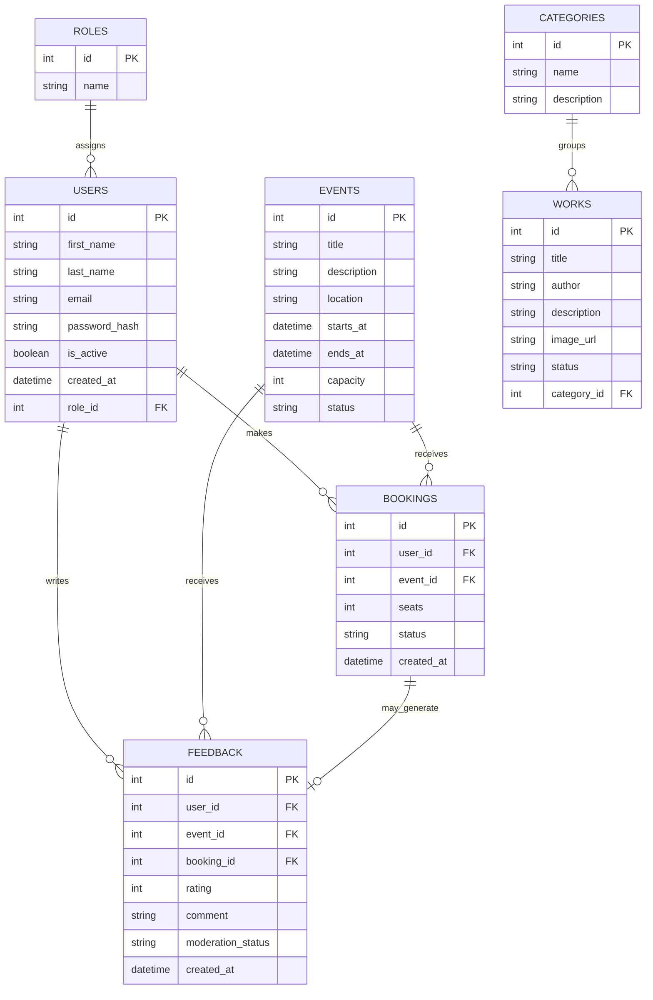

# Diagramma ER

`FEEDBACK.event_id` e `FEEDBACK.booking_id` sono nullable e il vincolo applicativo
impone che sia valorizzato uno solo dei due. La relazione con `BOOKINGS` è opzionale
dal punto di vista del feedback, mentre l’ownership della prenotazione è verificata
dal service.
